# Çka të re

## 1.0.102 (103) — 2026-11-14

Kujtesa për ditët me rëndësi, që dalin lart në ekran:
- Ramazani: një javë para tij dhe mbrëmjen para tij.
- Dhjetë netët e fundit: mbrëmjen kur fillojnë, për Natën e Kadrit.
- Zekati i fitrit: dy ditë para Fitër Bajramit.
- Fitër Bajrami, hyrja e dhul-hixhxhes, dita e Arafatit, Kurban Bajrami, Tasu'a dhe Ashura.
- Prekja e njoftimit hap faqen për atë ditë: pse agjërohet dhe si e agjëronte Pejgamberi ﷺ, me hadithet e sakta.
- Njoftimet dalin vetëm kur data është e shpallur zyrtarisht. Fiken te Kalendari hixhri.
Te Agjërimi: «Pse agjërohen këto ditë» – e hëna e e enjtja, ditët e bardha, Tasu'a dhe Ashura, Arafati, gjashtë ditët e shevalit.
Përmirësime të teksteve te udhëzuesit e Ramazanit dhe të bajrameve.

## 1.0.101 (102) — 2026-11-13

Kohët e namazit:
- Qielli tani është një i vetëm, nga lart deri poshtë: shiu e bora bien edhe pas kohëve të namazit, dhe xhamia qëndron poshtë, në tokë, në çdo mot.
- Shiu është më i butë dhe më i zbehtë aty ku janë shkronjat, që kohët të lexohen qartë.
- Pikat që bien në tokë spërkasin pranë xhamisë.
- Butoni pranë kalendarit e ndal animacionin e motit. Ndalimi mbahet mend edhe kur e hap app-in herën tjetër. Gjendet edhe te cilësimet: «Animacioni i motit».
Përkthimet:
- «Kurani do të vijë ndërmjetës për shoqëruesit e tij» (Muslimi 804).
- Suretul-Mulk: «ndërmjetësoi për një njeri derisa iu fal».
- Suretul-Kehf: «i ndriçon një dritë nga kjo xhuma deri në tjetrën».

## 1.0.100 (101) — 2026-11-13

Moti te kohët e namazit:
- Moti merret nga stacioni meteorologjik më i afërt (për Prishtinën: aeroporti), që e mat qiellin vërtet; vetëm kur s'ka stacion afër merret parashikimi.
- Pranë qytetit shkruhet si është qielli dhe temperatura, p.sh. «Shi i lehtë · 17°». Rifreskohet çdo 15 minuta.
- Shiu bie me pika të gjata, ato afër më të shpejta e më të ndritshme, dhe spërkat kur bie në tokë.
- Telefoni dridhet lehtë me pikat e shiut, më fort kur shiu forcohet, dhe një goditje kur vetëton. Fiket te cilësimet e kohëve: «Dridhja e shiut». S'dridhet kur telefoni është në heshtje.
Përkthimet:
- El-Bari dhe el-Khalik te 99 emrat: «i përsosi» (si te tefsiri i es-Sa'diut).

## 1.0.99 (100) — 2026-11-13

• Në makinë (Android Auto) tani ka gjithçka që ka zë: të 114 recituesit, përkthimin me zë të Hasan Nahit, ligjëratat në shqip, mësimet e el-Albanit, fetvatë e Ibn Bazit, mësimet e el-Feuzanit dhe dhikrin pas namazit e para gjumit me zë.
• Përkthimet u kontrolluan me kuptim në të gjitha gjuhët. U ndreqën disa fjali, si te kazaja e agjërimit («mund të agjërohen edhe të ndara»), te disa dua dhe te kuptimet e disa prej 99 emrave të Allahut.
• Kur një rresht në makinë s'gjen dot zërin, app-i nuk mbyllet më.

## 1.0.98 (99) — 2026-11-13

• Shiriti i luajtjes poshtë nuk del më vetë kur hap aplikacionin. Lart, te Kurani, del «Vazhdo dëgjimin» me suren dhe recituesin; një prekje e vazhdon aty ku mbeti.
• Shiriti del sapo nis recitimi, nga app-i ose nga makina.
• Lidhja me Bluetooth dhe makinën punon si më parë.

## 1.0.97 (98) — 2026-11-13

- **Trajneri i recitimit**: tani të tregon saktë ku gabove, fjalën dhe shkronjat e saj me të kuqe, si dhe çka dëgjoi telefoni. Fjalët që mus'hafi i shkruan ndryshe nga arabishtja e zakonshme nuk llogariten më gabim.
- **Kurani në ekran të plotë** mbulon tani gjithë ekranin, edhe pjesën e kamerës lart. Te tesbihu zëri shkon më shpejt kur e shpejton numërimin, dhe gishti i madh mbyllet në pëllëmbë si gishtat e tjerë.
- **Faqja kryesore**: ikonat lëvizin sërish kur bën scroll dhe kur i prek. «Kujtesa e ditës» është pllakë me ikonën e vet, «99 emrat e Allahut» janë të parët te dhikri dhe duaja, dhe bajramet e kurbani kanë ikona të reja.

## 1.0.96 (97) — 2026-11-13

- **Kurani në ekran të plotë**: butoni lart e lë vetëm tekstin; prek mes faqes ose shtyp kthehu për t'u kthyer. Cilësimet e leximit kanë pamje të re, me çelësa që shihet qartë a janë ndezur. Te «Luajtja dhe leximi» mund ta heqësh përkthimin dhe shqiptimin edhe nën recitimet, duke lënë vetëm arabishten.
- **Tesbihu me zë të vërtetë**: «Subhanallah», «Elhamdulilah» dhe «Allahu ekber» thuhen nga incizimet e «Hisnul Muslimit». Nyjet e gishtit të madh ndriçohen vetëm brenda tij, mes vijave të nyjeve, dhe gishti tregues zbret deri te rrënja e tij. Te grushti nuk vizatohen më thonjtë.

## 1.0.95 (96) — 2026-11-13

- **Kurani vetëm në arabisht**: te cilësimet e leximit mund ta heqësh shqiptimin, përkthimin ose të dyja. Zoom-i me dy gishta shkon deri në 400% dhe mbetet ashtu siç e lë.
- **Tesbihu**: nyja që preket ndriçohet saktë mes dy vijave të nyjeve, brenda gishtit, dhe gishti duket mbi gishtin e madh që e prek. Thonjtë në grusht duken si thonj të vërtetë. Kur zgjedh 10 · 10 · 10, shkruhet menjëherë ku thuhet (pas namazit dhe para gjumit), me hadithin e plotë, zinxhirin e transmetimit dhe vlerësimin.
- **Gjuhët e përkthimit** kanë pamje të re, dhe ikona e kurbanit është koka e një dashi me brirë.

## 1.0.94 (95) — 2026-11-13

- **Zoom te Kurani**: me dy gishta i zmadhon ose i zvogëlon shkronjat e arabishtes dhe të përkthimit, dhe teksti rreshtohet sipas ekranit.
- **Tesbihu me gishta**: te nyjet dhe majat gishti mbetet i shtrirë, që të dallohet cili gisht është dhe cila nyje; gishti i madh e prek nga anash. Dhikri thuhet me zë mashkulli. Në krye të faqes shkruan se vizatimi është vetëm për mësim dhe se tesbihu bëhet me dorën tënde.
- **Ikonat e bajrameve dhe kurbanit**: hëna e re mbi rreshtat e namazit të bajramit, dhe dashi me brirë për kurbanin.

## 1.0.93 (94) — 2026-11-13

- **Tesbihu me gishta**: dora është vizatuar si dorë e vërtetë, me tri nyjet e çdo gishti dhe gishtin e madh me gjatësinë e vet. Kur numëron me nyje ose me maja, gishti përkulet drejt gishtit të madh dhe gishti i madh e prek nyjen e ndezur; te gishti i madh e prek gishti tregues. Te majat numërimi shkon nga gishti i madh te i vogli e pastaj kthehet. Mund ta dëgjosh vetë dhikrin, «Subhanallah», «Elhamdulilah», «Allahu ekber», në çdo numër, ose vetëm një trokitje, ose asgjë. Poshtë dorës një vijë tregon sa ke numëruar; e tërheq për t'u kthyer te cilido numër.
- **Me kohën e namazit**: nga dreka deri në ikindi sfondi është Smeraldi, kurse natën, pas jacisë, është sfondi i qetë.
- **Ikona e tesbihut** te faqja kryesore është tani dora e djathtë me të pesë gishtat.

## 1.0.92 (93) — 2026-11-12

- **Tesbihu në tri mënyra**: me gishtin e plotë, me nyjet (tri poshtë e tri lart në çdo gisht, ose një gisht lart e tjetri poshtë) dhe vetëm me majat e gishtave. Nyjet e gishtit të madh preken me gishtin tregues. Për secilën mënyrë faqja tregon çfarë kanë thënë dijetarët dhe ku gjendet.
- **Shpejtësia dhe zëri i prekjes**: numërimin e bën më të ngadaltë ose më të shpejtë, dhe çdo prekje dëgjohet. Kur telefoni është në heshtje, zëri nuk bie.
- **Temat dhe sfondet**: Agimi dhe sfondi sipas kohës së namazit kanë ngjyra të ngrohta, pa asnjë nuancë vjollcë; pllakat, kartat dhe ikonat i përshtaten sfondit në çdo temë, të errët e të çelët.

## 1.0.91 (92) — 2026-11-12

- **Tesbihu me dorë**: si numërohet me gishtat e dorës së djathtë, me burimet e transmetimit.
- **99 emrat e Allahut** me shpjegimin e es-Sa'diut.
- **Ndaj kohët e namazit si foto**, drejt nga Takvimi.
- **Më shumë recitues**: u kthyen ata që mungonin, bashkë me disa të rinj.
- **Çdo gjuhë në gjuhën e vet**: kujtesat, dhikri, ditët e agjërimit dhe xhumaja janë përkthyer në të gjitha gjuhët; në arabisht orët dhe datat shkruhen njësoj kudo.
- Recitimi nuk ndalet më kur serveri është i zënë; rregullime në pamje dhe në siguri.

## 1.0.90 (91) — 2026-11-11

- **Zakoni i leximit**: sa ditë rresht e ke lexuar Kuranin, minutat e sotme dhe java.
- **Kupto xhuzin Amme**: plan 37-ditor, një sure në ditë me tefsirin e es-Sa'diut.
- **Kreu më i pastër**: Qëllimet dhe Kujtesa e ditës janë tani te pjesa e Sunetit.

## 1.0.89 (90) — 2026-11-11

- **Qëllimet**: zgjidh vepra nga Suneti (namazi me xhemat, 12 rekatet e sunetit, Duha, vitri, një faqe Kuran, istigfari, agjërimi i së hënës dhe së enjtes e të tjera), secila me hadithin dhe burimin e saj, dhe shëno çdo ditë kur i bën.
- **Nafilet e ditës te Takvimi**: koha e Duhasë dhe e treta e fundit e natës, për qytetin tënd.
- **Kujtesa e ditës te Kreu**: një vepër e Sunetit me shpërblimin dhe burimin.

## 1.0.88 (89) — 2026-11-11

- **Hyrja me Besmele**: aplikacioni hapet me «Bismil-lahir-Rahmanir-Rahim» dhe kuptimin e saj.
- **Tema «E qetë»**: faqe mat, karta të sheshta dhe ikona të qeta, pa shkëlqime, më e lehtë për sytë. Është tani parazgjedhja; sfondet e tjera mbeten te Cilësimet → Pamja.

## 1.0.87 (88) — 2026-11-11

- **Mustafa Ismail i plotë**: të 114 suret (muxhaued), me tekstin që ndjek zërin ajet për ajet.
- **Islam Sobhi dhe Hazza Al-Balushi**: tani me të 114 suret.

## 1.0.86 (87) — 2026-11-11

- **Çdo gjuhë vetëm në gjuhën e vet**: tekstet e reja kanë përkthim në të gjitha gjuhët.
- **Te Pamja faqja mbetet aty ku ishe** kur ndërron temën.

## 1.0.85 (86) — 2026-11-11

- **Teksti ndjek zërin edhe te suret e plota**: kohët e ajeteve vijnë tani nga serveri ynë quran.jami.tv.

## 1.0.84 (85) — 2026-11-11

- **50 recituesit më të dëgjuar**, të gjithë nga serveri ynë quran.jami.tv.

## 1.0.83 (84) — 2026-11-11

- **Tema dhe sfondi në një vend**: te Cilësimet → Pamja zgjedh bashkë temën (si sistemi, e errët, e bardhë) dhe sfondin.
- **Pamja në hapjen e parë**: kur instalohet aplikacioni, zgjedh temën dhe sfondin para kohëve të namazit.

## 1.0.82 (83) — 2026-11-11

- **Recitimet nga serveri ynë me adresat tona**: ajetet nga quran.jami.tv/ayat dhe suret e plota nga quran.jami.tv/sure/emri-i-recituesit.

## 1.0.81 (82) — 2026-11-11

- **Recituesit me logon e Kuranit**: çdo recitues ka tani logon e rahles; ata që i ke shkarkuar kanë shenjën e gjelbër ✓ në qoshe.
- **Logoja lart majtas** të kthen te Kreu nga çdo faqe.
- **Me kohën e namazit**: në drekë del tani Smeraldi, gjelbra e logos. Te Sfondi shkruan cilat janë statike dhe cili ndërrohet; «Statik» quhet tani «E zezë».
- **Tema** ka tani vetëm «Si sistemi», «E errët» dhe «E bardhë»; ngjyrat e faqes zgjidhen te Sfondi, pa dyfishim.
- **Ajeti që po lexohet**: shembujt te Cilësimet tregojnë ajete të vërteta, me ajetin e ndriçuar me ar.

## 1.0.80 (81) — 2026-11-11

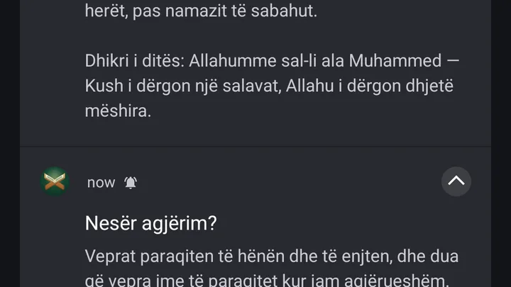
- **Recituesit nga serveri ynë**: 50 recituesit më të dëgjuar (Maher Al-Muaiqly, Alafasy, Sudais, Shuraim, Ghamdi, Husary, Minshawi, Abdul Basit, Yasser Al-Dosari, Raad Al-Kurdi, Islam Sobhi, Aziz Alili e të tjerë) luajnë tani nga quran.jami.tv. Teksti ndjek zërin fjalë për fjalë si më parë; nëse serveri s'përgjigjet, kalon vetë te hosti origjinal.
- **Njoftimet më të pastra**: pa thonjëza dhe pa burim në njoftim, vetëm fjalët e hadithit ose të dhikrit.

## 1.0.79 (80) — 2026-11-10

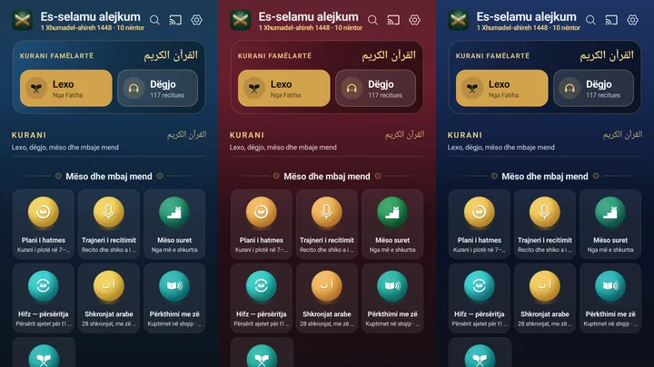
- **Me kohën e namazit** me ngjyra më të qeta, si qielli: sabahu blu e agimit, akshami bordo e errët, nata blu e mesnatës. Vjollca dhe roza janë hequr.
- **Smeraldi**: Hadithi dhe Faida e ditës janë tani të gjelbra, në ngjyrën e sfondit.

## 1.0.78 (79) — 2026-11-10

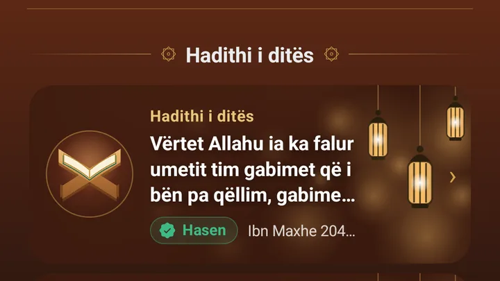
- **Hadithi i ditës** dhe **Faida e ditës** marrin tani ngjyrën e sfondit: me «Me kohën e namazit» ndërrohen sipas kohës, me «Statik» dalin në ngjyrën e thjeshtë.
- Kur ndërron sfondin, Kurani dhe kartat e Kreut ndërrohen menjëherë, pa e mbyllur aplikacionin.

## 1.0.77 (78) — 2026-11-10

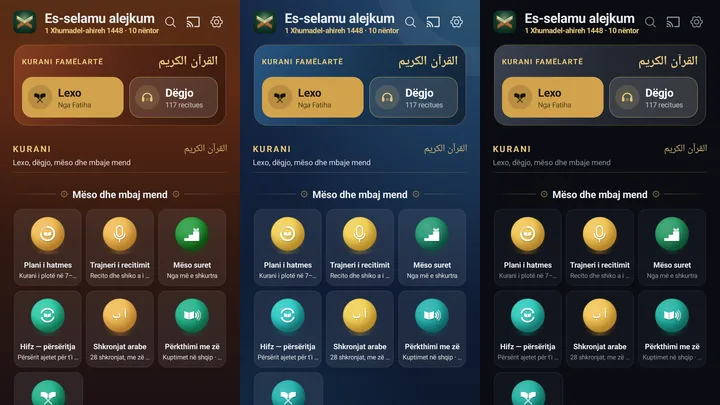
- **Kurani në Kreu dhe hyrja me rahlen** marrin tani ngjyrën e sfondit që ke zgjedhur: me «Me kohën e namazit» ndërrohen sipas kohës, me «Statik» dalin në ngjyrën e thjeshtë, me Natën blu, me Agimin bakër. Te Smeraldi mbeten të gjelbra.

## 1.0.76 (77) — 2026-11-10

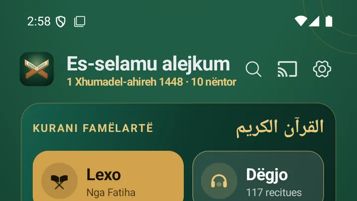
- **Me kohën e namazit** tani është sfondi që del vetë: ngjyra ndërrohet sipas kohës së namazit gjatë ditës. Sfondet e tjera i zgjedh te Cilësimet → Pamja → Sfondi.
- **Smeraldi** dhe **Agimi**: vijat që kalonin nëpër tekst janë hequr nga mesi i ekranit dhe tani janë të vogla në qoshen lart djathtas, që teksti të lexohet pastër.

## 1.0.75 (76) — 2026-11-10

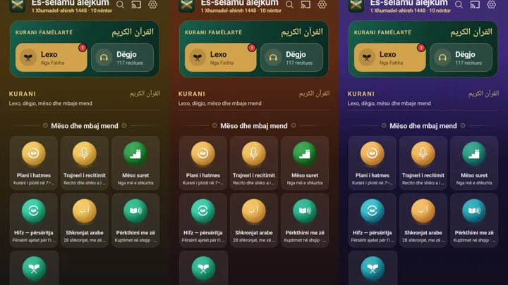
- **Me kohën e namazit**: tani çdo kohë ka ngjyrën e vet — agimi rozë, mëngjesi ari, dreka gjelbër deti, ikindia bakër, akshami vishnje, nata vjollcë — dhe ndërrohet vetë kur hyn koha.

## 1.0.74 (75) — 2026-11-10

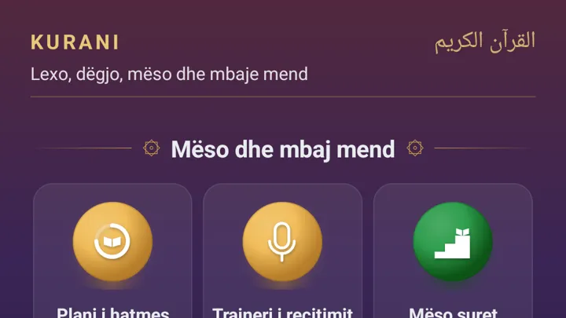
- **Mëngjesi dhe mbrëmja më të errëta**: ikonat e pllakave tani dallohen qartë mbi sfond.
- Pikat e arta u hoqën.

## 1.0.73 (74) — 2026-11-10

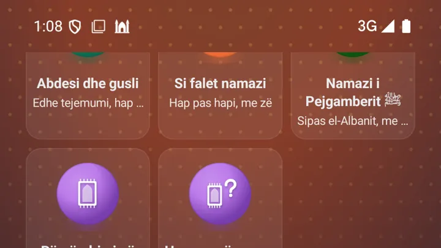
- **Pa shirit të zi lart**: kur bën scroll, sfondi vazhdon deri te ora, pa asnjë pengesë.

## 1.0.72 (73) — 2026-11-09

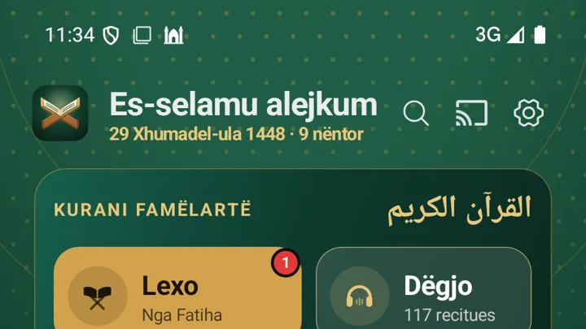
- **Pika të arta mbi sfond**: rrathë të imët në ari, si zbukurimi i Mushafit, që zbehen nga lart.

## 1.0.71 (72) — 2026-11-09

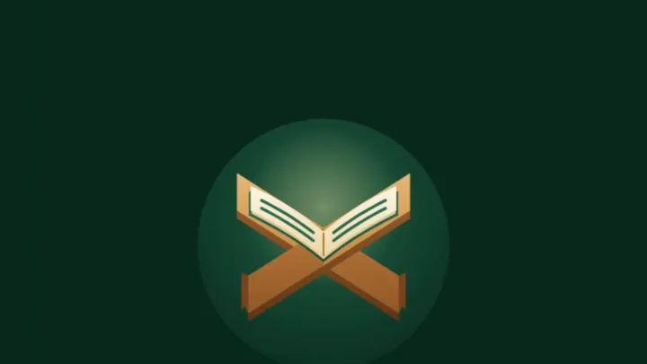
- **Hapja me një ngjyrë**: ekrani i parë kur e hap aplikacionin tani merr ngjyrën e sfondit tënd në gjithë ekranin, edhe nën orë.

## 1.0.70 (71) — 2026-11-09

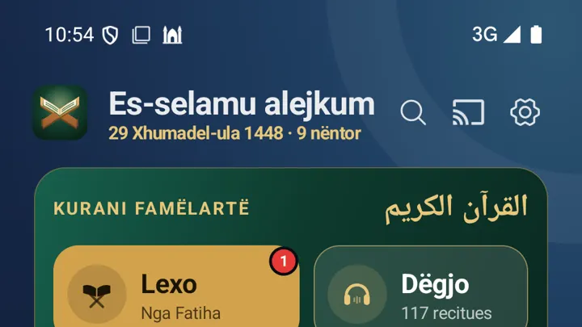
- **Teksti i qartë në çdo sfond**: titujt, ari dhe përshkrimet tani lexohen mirë mbi çdo sfond.
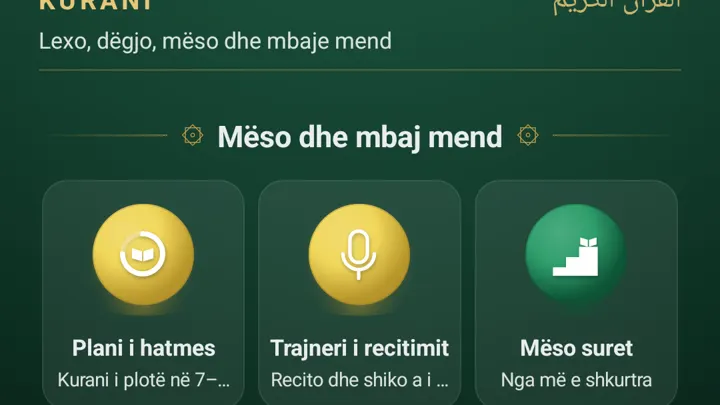
- **Smeraldi nga logoja** është sfondi i ri, dhe ikonat e pllakave marrin pak ngjyrën e sfondit. Ndërrohet te Cilësimet → Pamja → «Pllakat sipas sfondit».
- Takvimi numëron deri te Sabahu; në Ramazan deri në Imsak.
- Hapja me temën e çelët: shkronjat dhe «Lexo!» tani duken qartë.
- Te Pamja, parapamjet tregojnë aplikacionin mbi sfondin që zgjedh.

## 1.0.69 (70) — 2026-11-09

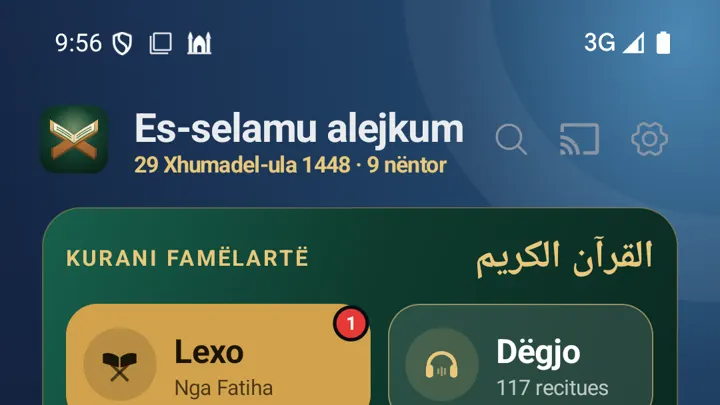
- **Sfondi në gjithë ekranin**: tani vazhdon edhe nën orë dhe nën shiritin poshtë, pa vija.

- **Pllakat si xham**: marrin ngjyrën e sfondit, jo më blloqe të errëta.
- Njoftimi i përditësimit tani shkruan vetëm çka ka të re, pa lidhje.

## 1.0.68 (69) — 2026-11-09

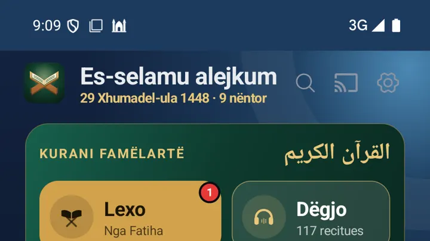
- **Sfond i ri për gjithë ekranin**: Nata e kaltër, Agimi, Smeraldi, ose Me kohën e namazit, që ndryshon me namazin që është në kohë.
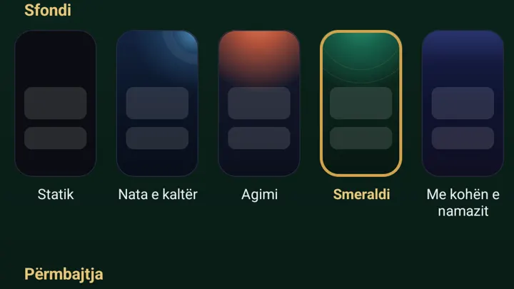
- Zgjidhe te **Cilësimet → Pamja → Sfondi**. «Statik» e lë si më parë.
- Parapamjet te «Kështu duket» tani janë të qeta, pa shkëlqim.

## 1.0.67 (68) — 2026-11-09

- Dritarja e përditësimeve tani është në Material 3, me ngjyrat e aplikacionit. Nga përditësimi i ardhshëm, çdo gjë e re do të ketë edhe foton e vet.

## 1.0.66 (67) — 2026-11-09

- Takvimi: kur zgjedh një ditë tjetër, shkruan sa larg është (Nesër, pas 4 ditësh) dhe butoni thotë «Kthehu te sot».
- Forma e ikonave ndërrohet menjëherë edhe te Kreu, pa e mbyllur aplikacionin.

## 1.0.65 (66) — 2026-11-09

- Forma e ikonave (Cilësimet → Pamja): secila formë shihet si ikonë e vërtetë me ngjyrë, ajo e zgjedhura me ✓.

## 1.0.64 (65) — 2026-11-09

- Hapja: shkronjat bien në Mushaf, del «ٱقْرَأْ» dhe «Lexo!» në gjuhën tënde, pastaj el-‘Alek 96:1. Del sa herë e hap aplikacionin.
- Takvimi: rreshti i ditëve lart (‹ › ose rrëshqit për javën tjetër), rrethi «e fala» te secili namaz, dhe unaza e ditës mbushet me to.
- Java dhe Muaji hapen menjëherë, pa ekran të zi.
- Cilësimet e kohëve: kohët ndjekin vendndodhjen e telefonit kur udhëton, dhe minuta për secilën kohë sipas xhamisë tënde.
- Kohët e ditës mund të jenë gjithmonë te njoftimet, me harkun e diellit (Kur të njoftohem → Kohët e ditës gjithmonë te njoftimet).
- Kibla: dy busulla të reja, Kopshti dhe Letra.
- Widget i ri: Ajeti i ditës.
- Në Ramazan: kartela me fenerë në krye të Kreut (dita e Ramazanit dhe sa ka deri në iftar ose në fund të syfyrit), dhe fenerët te hapja.

## 1.0.63 (64) — 2026-11-09

# Kibla
- **Busulla · Shigjeta · Harta** poshtë ekranit
- Pesë pamje të busullës, zgjidhi poshtë saj: e zakonshmja, Blu e natës, Mushafi, Fildish, Nata me fener
- Shigjeta: një shigjetë e madhe drejt Kibles, me gjerësinë dhe gjatësinë
- Harta: rruga më e shkurtër deri te Qabeja
# Hapja
- Shkronjat bien në Mushaf; poshtë «اقْرَأْ بِاسْمِ رَبِّكَ» dhe «Lexo siç ka zbritur nga Allahu i Madhërishëm»
# Kujtesa të buta
- Një herë në ditë, në orë të ndryshme, larg kohëve të namazit: Kurani, dija, duaja, sadakaja, agjërimi i së hënës dhe së enjtes, vitri
- Dhikri i mëngjesit dhe i mbrëmjes me fjalë të ndryshme çdo ditë
# Kreu
- Scroll-i mbi takvim s'i hap më pllakat për ndryshim
- Takvimi i Kreut hap faqen e re të kohëve të namazit
- Cilësimet → Pamja → **Pllakat e Kreut**: kthe të fshehurat, ose Kreun si në fillim
- Hiqet oferta e Jamyx-it

## 1.0.62 (63) — 2026-11-09

# Heshtja
- Heshtja me orar, pa vendndodhje: telefoni hesht në kohën e namazit sipas qytetit që ke zgjedhur
- Zgjedh namazet, sa minuta pas ezanit dhe sa zgjat; xhumaja veç
# Kreu
- Pllakat hiqen vetëm me prekje të plotë te ✕; «Kthe» menjëherë pas heqjes
- «Pllakat e fshehura» poshtë Kreut — i kthen kur të duash
- Mbajtja për ndryshim madhësie zgjat pak më shumë
# Pamja
- Forma e ikonave: rreth, katror, katror i butë, lule, hark
- Përditësimi vjen si kartë me «Çka ka të re»

## 1.0.61 (62) — 2026-11-05

Kibla: shigjeta s'lëviz më kur telefoni mbahet pak i anuar anash. Trajneri i recitimit të çon te shkronjat kur një ajet s'del. Ramazani me fenerë.

## 1.0.60 (61) — 2026-11-04

E re: Trajneri i recitimit — recito një ajet dhe shiko cilat fjalë i the saktë. Kohët e namazit: zile te çdo namaz, Sot · Java · Muaji. Pamje e njëjtë për zgjedhjet kudo.

## 1.0.58 (59) — 2026-11-04

Listat me pamje të re dhe kërkim lart; zgjedhja e qytetit pa flamuj.

## 1.0.57 (58) — 2026-11-04

Zgjedhja e qytetit për kohët e namazit: kërkimi lart, shtetet me flamuj. «In shaa Allah» i shkruar saktë.

## 1.0.56 (57) — 2026-11-04

Ndreqje të vogla në tekstet e hatmes.

## 1.0.55 (56) — 2026-11-04

Ndreqje të vogla në tekstet e hatmes.

## 1.0.54 (55) — 2026-11-04

Hatmja: «Elhamdulil-lah» kur e mbaron, «Bismil-lah» kur e fillon. Tekste më të ngrohta te kohët e namazit.

## 1.0.53 (54) — 2026-11-04

Kohët e namazit funksionojnë për çdo vend të botës edhe pa internet; njoftimi i dhikrit të mëngjesit vjen edhe jashtë Kosovës dhe Shqipërisë.

## 1.0.52 (53) — 2026-11-04

Kohët e dhikrit dhe të duasë sipas fetvave të shejh Ibn Bazit; njoftimi i xhumasë pas ikindisë. Hadithi dhe faida e ditës me sfond të ri me fenerë.

## 1.0.51 (52) — 2026-11-04

Dhikri çdo ditë: njoftim për dhikrin e mëngjesit dhe të mbrëmjes në kohën e tyre, për të tretën e fundit të natës dhe për orën e fundit të xhumasë. Faqja e re «Koha e dhikrit dhe e duasë» tregon kur pranohet duaja, me hadithet.

## 1.0.50 (51) — 2026-11-03

E re: fjala e mirë e ditës — një herë në ditë, kur s'e ke hapur app-in: hadithi i ditës, një nga emrat e Allahut, dhikri i mëngjesit, një dua ose një mësim. Fiket te Njoftimet.

## 1.0.49 (50) — 2026-11-03

Mesazhet e shkarkimit të Kuranit dhe të televizorit dalin tani në krye, si gjithë të tjerat.

## 1.0.48 (49) — 2026-11-02

E re: «Zëri në altoparlant» te Kreu — fol në mikrofon dhe dëgjohesh nga altoparlanti Bluetooth, vetëm ose mbi recitimin. Njoftimet dalin në krye, një herë.

## 1.0.47 (48) — 2026-10-27

Heshtja në xhami: pllakë e vogël te Kreu, rresht te Cilësimet dhe buton «Hesht në xhami» te njoftimi i namazit.

## 1.0.46 (47) — 2026-10-27

Kreu rregullohet si të duash: edhe Kurani, Takvimi, Hadithi dhe Faida e ditës bëhen më të mëdha ose më të vogla. Mbaje gjatë një pllakë dhe tërhiq dorezat.

## 1.0.45 (46) — 2026-10-27

«Libri i Teuhidit» i shejh el-Feuzanit tani lexohet brenda aplikacionit, me kapituj dhe tema. Pamja e re Material 3: çelësat, dritaret dhe zgjedhjet.

## 1.0.44 (45) — 2026-10-27

Pllakat e Kreut si widget: mbaje gjatë, tërhiq dorezat për madhësinë, tërhiqe pllakën për ta lëvizur. Faqja mbetet aty ku je.

## 1.0.43 (44) — 2026-10-27

Heshtja në xhami: lejet tani janë te Cilësimet → Lejet, secila me arsyen pse duhet. Parazgjedhje: heshtet menjëherë, rrezja 100 m, heshtje e plotë.

## 1.0.42 (43) — 2026-10-26

Widget-e të reja: Ramazani (ditët deri në Ramazan) dhe Emri i ditës. Shiriti i recitimit qëndron saktë mbi menunë.

## 1.0.41 (42) — 2026-10-26

Kurbani: dispozitat e therjes së kurbanit sipas shejh Ibn Uthejminit. Ramazani tregon sa ditë ka mbetur dhe sa ditë është. Ramazani bashkë me agjërimin. Shiriti i dëgjimit ulur mbi menunë.

## 1.0.40 (41) — 2026-10-26

Udhëzues të shkurtër herën e parë: pllakat e Kreut, Kibla dhe Heshtja në xhami.

## 1.0.39 (40) — 2026-10-26

Shiriti i dëgjimit i rrumbullakët, ulur drejt mbi menunë.

## 1.0.38 (39) — 2026-10-26

Shiriti i dëgjimit ngjitur me menunë. Mbaje dhe tërhiqe poshtë te «✕ Mbylle». Kreu me ndarës të rinj; kohët e namazit nën «Takvimi».

## 1.0.37 (38) — 2026-10-26

Heshtja në xhami: edhe xhamitë e Maqedonisë së Veriut (vetëm xhami). Kibla: «Si llogaritet kibla» dhe «Kalibro busullën». Ikona të reja kudo.

## 1.0.36 (37) — 2026-10-26

Heshtja në xhami: zgjidh vetëm xhamitë ku do të heshtë (Kosova ose Shqipëria, me kërkim dhe largësi). Kibla: «Kalibro busullën» dhe shpjegimi pse ndryshon nga disa app. Kreu: mjetet (takvimi, njoftimet, kibla, kalendari, xhamitë) në grupin e vet. Shiriti i dëgjimit dhe menuja më afër njëra-tjetrës.

## 1.0.35 (36) — 2026-10-26

Kreu në radhën që e mësojnë dijetarët: Akideja, Shtyllat e Islamit (pastërtia dhe namazi, zekati, agjërimi, haxhi), Suneti, Jeta e muslimanit. Kur bën scroll poshtë, menuja mblidhet dhe shiriti i dëgjimit ngushtohet; lart kthehet.

## 1.0.34 (35) — 2026-10-26

Kreu: shtyp gjatë një pllakë për ta bërë më të madhe ose më të vogël, për ta lëvizur ose fshehur (si widget). Kreu i riorganizuar: Kurani bashkë, kohët e namazit nën Namazi, hadithi i ditës nën Hadithet. Player-i: ikona të reja, mënyrat e tekstit, shiriti i muzikës më i hollë, mbaje dhe tërhiqe poshtë te ✕ për ta mbyllur.

## 1.0.33 (34) — 2026-10-26

Heshtja në xhami: s'të del më njoftimi «Telefoni heshtet sapo të hysh» kur je në shtëpi — kontrolli në kohët e namazit bëhet pa njoftim (çdo 5 minuta), dhe heshtet vetëm kur je brenda rrethit të xhamisë; edhe kur e hap Jamin brenda xhamisë, heshtet menjëherë. Kibla: shenja tregon nga sheh telefoni dhe ku është Qabja; kur je drejt kibles rrethi bëhet i artë me ✓. Namazi i Pejgamberit ﷺ: nijeti vetëm me zemër.

## 1.0.32 (33) — 2026-10-23

Kohët e namazit: pas Jacisë numëron deri në Imsakun e nesërm (s'mbetet më në «00:00 · Deri në Jaci»). Heshtja në xhami: zilja kthehet sapo del nga rrethi që ke zgjedhur (30/50/100 m), jo dyfishi i tij; njoftimi «Telefoni heshtet sapo të hysh» s'del më në shtëpi në kohët e namazit. Dita e xhumasë me logon e Jamit — Mushafi mbi rahle.

## 1.0.31 (32) — 2026-10-22

Kreu i ri: Kurani në krye (Lexo · Dëgjo) dhe namazi i radhës me numërim. Ikonat në 3D, me animacione (mund t'i kthesh të sheshta te Pamja). Kibla më e qartë. Lexuesi i Kuranit me shirit poshtë: Dëgjo, Ruaj, Lëviz, Ndaj, Tefsiri. E re: «Namazi i Pejgamberit ﷺ» sipas el-Albanit; «Akideja» – librat e el-Feuzanit, el-Albanit, Ibn Bazit dhe Ibn Uthejminit; «Udhëzime për besimtaret» (el-Feuzani). Heshtja në xhami e shpjeguar, udhëzimet e para, tema e çelët me karta të bardha.

## 1.0.30 (31) — 2026-10-21

Kutia «Si ta kuptosh dallimin» tani në gjithë app-in: te udhëzuesit e namazit, udhëtarit, haxhit, abdesit, sehvit, të sëmurit dhe xhenazes, si dhe te Kazatë, Trashëgimia e Zekati – ku pajtohen dijetarët, ku jo, dhe çka mban shumica e katër medhhebeve.

## 1.0.29 (30) — 2026-10-21

Te Ramazani, Agjërimi e Bajramet: kudo ku dijetarët dallojnë, kutia «Si ta kuptosh dallimin» e shpjegon me fjalë të thjeshta – ku pajtohen, ku jo, dhe çka mban shumica e dijetarëve të katër medhhebeve. Hadithet dhe fetvatë hapen tani si faqe që i kthen me rrëshqitje, si udhëzuesit; tekstet e gjata mbyllen me «Lexo krejt».

## 1.0.28 (29) — 2026-10-20

Njoftimet si mesazhet: ikona tregon që ke njoftim, në krye të Kreut shfaqet «Njoftime të reja» me pjesën ku i takon (kohët e namazit, kalendari, Kurani, shkarkimet, përditësimi), dhe njoftimi hiqet sapo e hap atë pjesë. Prekja e njoftimit të namazit hap kohët e namazit.

## 1.0.27 (28) — 2026-10-20

Udhëzuesit me pamje të re: çdo pyetje në faqe më vete, me swipe majtas-djathtas; përgjigjja shkurt në krye dhe çdo dijetar në një rresht që hapet me prekje. Te Ramazani, Agjërimi dhe Bajramet tani edhe shejh Ibn Uthejmini e shejh el-Feuzani, me burimin e çdo fjale. E re: si falet namazi i bajramit, hap pas hapi.

## 1.0.26 (27) — 2026-10-20

Të reja te Kryefaqja, "Ramazani dhe bajramet": Ramazani, Agjërimi dhe Bajramet (Fitri e Kurbani) — çdo pyetje me fjalën e shejh Ibn Bazit dhe të shejh el-Albanit, secila me burimin, edhe aty ku mendimet e tyre dallojnë. Burimi nën hadithe dhe dua shfaqet tani i plotë.

## 1.0.25 (26) — 2026-10-19

Ekrani i kyçur dhe njoftimi s'tregojnë më logon e mp3quran.net — ajo figurë ishte brenda skedarëve audio të recituesve.

## 1.0.24 (25) — 2026-10-19

Heshtja në xhami: njoftimi «Telefoni heshtet sapo të hysh» s'del më kur je në shtëpi ose larg xhamisë — vetëm kur je te dera e xhamisë ose po shkon drejt saj në kohën e namazit. Zilja vazhdon të mos kthehet në mes të namazit.

## 1.0.23 (24) — 2026-10-19

Heshtja në xhami: zilja s'kthehet më në mes të namazit kur telefoni e humb vendin për një çast — Jami e kontrollon vetë para se ta kthejë. Në kohën e namazit, kur je afër xhamisë, Jami e ndjek telefonin derisa të hysh, që heshtja të vijë sapo hyn.

## 1.0.22 (23) — 2026-10-19

Te Shkronjat arabe, prek shkronjën dhe dëgjon emrin e saj: «Elif», «Ba», «Ta». E re: «Shkruaje me gisht» — e ndjek shkronjën në ekran dhe të thotë sa mirë e bëre. Recitues të rinj: Islam Sobhi, Muhammad Al-Luhaidan, Abdullah Al-Kandari, Hazza Al-Balushi dhe Nasser Al-Majed; recituesit gjenden edhe kur emri shkruhet ndryshe, p.sh. «Muhamed Kurdi». U rregullua: kur kërkoje një sure te faqja e recituesit, ndonjëherë sura nuk dukej.

## 1.0.21 (22) — 2026-10-15

Pas ikindisë karta e namazit tregon dy mendimet: të Ibn Bazit dhe të el-Albanit, me burimet. Te Shkronjat arabe, prek shkronjën dhe e dëgjon me të tri zanoret.

## 1.0.20 (21) — 2026-10-15

Heshtja në xhami: zilja tani ndërrohet nga shërbimi i Jami-t edhe kur aplikacioni është i mbyllur. Të drejtat e autorit për Kuranin dhe librat. Profili i ri nis me shkronjën e emrit.

## 1.0.19 (20) — 2026-10-14

Kërko në gjithë aplikacionin me 🔍 pranë Cast-it. Ikona të reja që lëvizin. Duatë dhe dhikri si kartela. Ajetul-Kursija me arabisht te «Para gjumit».

## 1.0.18 (19) — 2026-10-14

Udhëzuesi i haxhit lidhet me fetvatë e Ibn Bazit; heshtja në xhami e thotë qartë lejen «Alarmet dhe kujtesat».

## 1.0.17 (18) — 2026-10-13

Trashëgimia sipas Ibn Uthejminit; zekati i fitrit sipas Ibn Bazit; kazatë e agjërimit dhe të namazit; salavatet në kujtesën e xhumasë; haxhi dhe umreja sipas el-Albanit.

## 1.0.16 (17) — 2026-10-13

Texhvidi me ngjyra: te leximi (⚙), me kuptimin e çdo ngjyre — gunneja, ikhfa, iklabi, idgami, meddet, kalkalja.

## 1.0.15 (16) — 2026-10-13

Përmirësime të vogla: të dhënat e marra nga quran.com rifreskohen çdo javë, siç i kërkojnë kushtet e tyre.

## 1.0.14 (15) — 2026-10-13

Tefsiri i Sa'diut: libri shqip hapet te faqja e ajetit (shkarkohet një herë nga IslamHouse), dhe origjinali arabisht ajet për ajet.

## 1.0.13 (14) — 2026-10-13

Leximi: ruaj ajetet me shënimet e tua, sexhdet e tilavetit të shënuara, dhe shko te çdo xhuz, hizb ose faqe.

## 1.0.12 (13) — 2026-10-13

Shkronjat arabe: 28 shkronjat me emrin, format dhe si shqiptohen, me zë nga Kurani; zanoret dhe një provim i vogël.

## 1.0.11 (12) — 2026-10-13

Widget-i i namazit: kohët e ditës poshtë më të mëdha dhe të gjitha të një madhësie, mbi një shirit që lexohet mbi çdo qiell.

## 1.0.10 (11) — 2026-10-13

Ikonat e reja: secila tregon saktë punën e vet.

## 1.0.9 (10) — 2026-10-13

Ikona e re për abdesin: rubineti me pika uji.

## 1.0.8 (9) — 2026-10-13

Widget-i i kohëve të namazit merr motin e jashtëm: shi, borë, re e mjegull, si në aplikacion.

## 1.0.7 (8) — 2026-10-12

Hadithet me referencë: libri, numri dhe zinxhiri i transmetimit. Takvimi merr motin e jashtëm: re, shi, borë, mjegull. Heshtja në xhami: zgjidh sa shpejt heshtet, dhe në kohët e namazit telefoni shikon vetë a je në xhami.

## 1.0.6 (7) — 2026-10-12

«Nuk ka të adhuruar tjetër që meriton të adhurohet përveç Allahut» kudo, pas auditimit të një hoxhe. Namazi i udhëtarit sipas shejh el-Albanit. Hadithet për marrëdhëniet intime nuk shfaqen më. Tri widget-e të reja: Hadithi i ditës, Vazhdo leximin, Data hixhri. Nëse vëreni gabim në ndonjë tekst, na shkruani — tani me një prekje.

## 1.0.5 (6) — 2026-10-12

Dëgjimet e tua pa fjalë muzike: sure, mësime, ditë. Njoftimet e namazit me ikonën e aplikacionit dhe fjalët e ezanit; kujtesa e Kuranit një herë në ditë. Shenja e gjelbër «Sahih» te çdo hadith. Si falet namazi: veshët nuk preken. Xhenazja me argumentet. Recituesit pa fotografi. Tekste më të qarta kudo.

## 1.0.4 (5) — 2026-10-06

• Namazi i të sëmurit: si pastrohet dhe si falet, sipas Ibn Uthejminit.
• Rukja: Kurani dhe duatë e Profetit ﷺ, me zë.
• Xhenazja: nga larja te ngushëllimi, me praktikën e namazit të xhenazes.
• Fetvatë e Ibn Bazit sipas temave, te Transkriptet.
• Faida e ditës, te Kreu.
• Zekati: llogaritësi sipas fetvave të Ibn Bazit (ari 92 g, argjendi 644 g).
• Te udhëzuesit: «Ndalo» për zërin, dhe ajetet rresht për rresht.
• Kreu përshëndet me «Es-selamu alejkum».

## 1.0.3 (4) — 2026-10-06

• Referencat: te Cilësimet, çdo libër, autor dhe përkthyes me emër — pa linke poshtë çdo gjëje.
• Abdesi, gusli dhe tejemumi: hap pas hapi, me duatë dhe «Praktiko abdesin».
• Harrova në namaz: zgjidh çka të ndodhi dhe e sheh çka bëhet — sexhdeja e harresës, para apo pas selamit.
• Karta e namazit të thotë kur është kohë e ndaluar për nafile.
• Recituesit, tre në rresht.

## 1.0.2 (3) — 2026-10-06

• Kur pritet një faqe tjetër: vetëm një hark i artë që rrotullohet, pa tekst.
• «Merr nga Jamyx» — Jami Music tani quhet Jamyx. Hatmja, hifzi, kohët e namazit, njoftimet, leximi dhe recitimet e shkarkuara vijnë me një prekje.

## 1.0.1 (2) — 2026-10-06

App-i i parë më vete i Islamit, i ndarë nga Jami Music.
• Ikona e re: Mushafi i hapur mbi rahle — edhe në hyrje dhe te hadithi i ditës.
• Mëso suret: nga më e shkurtra te më e gjata. Dëgjoje, ajet pas ajeti (3, 5 ose 7 herë, ose duke i lidhur 1 · 2 · 1–2 · 3 …), provo veten me tekstin e fshehur, fjalë për fjalë me një prekje, «E mësova».
• 99 emrat e Allahut sipas Ibn Uthejminit — 81 nga Kurani, 18 nga Suneti i saktë — secili me argumentin e vet.
• Transkriptet: libra, artikuj, ligjërata dhe fetva në shqip nga IslamHouse; mësimet e shejh Salih el-Feuzanit; el-Albani dhe Ibn Bazi.
• Përkthimi i Kuranit me zë (Hasan Nahi).
• Kur pritet një faqe tjetër: një hark i artë që rrotullohet, me emrin e saj.
• «Merr nga Jami Music»: hatmja, alarmet, njoftimet e namazit dhe recitimet e shkarkuara vijnë me një prekje.
